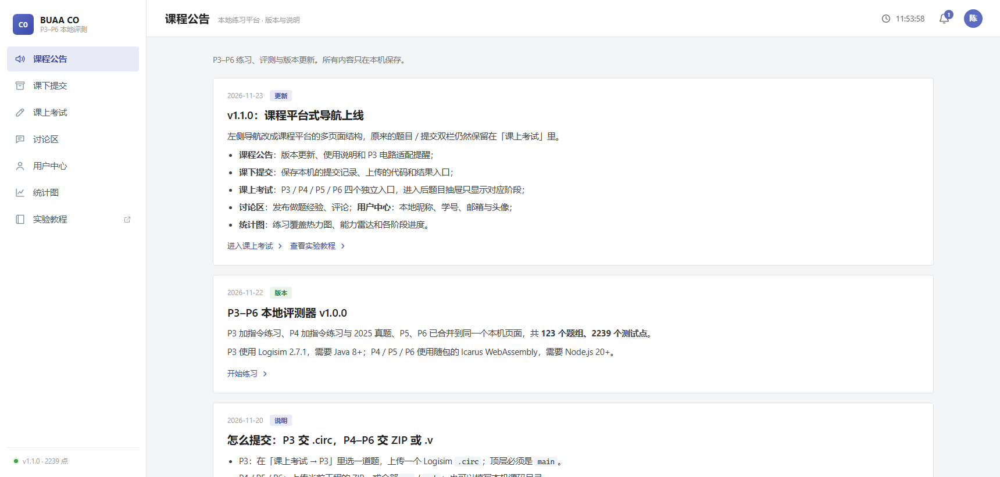
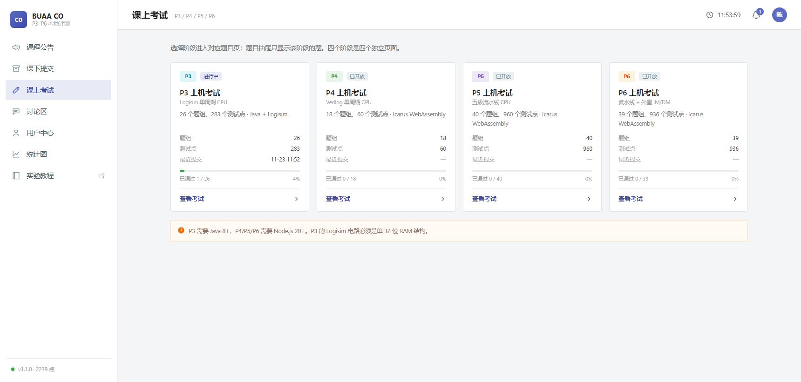
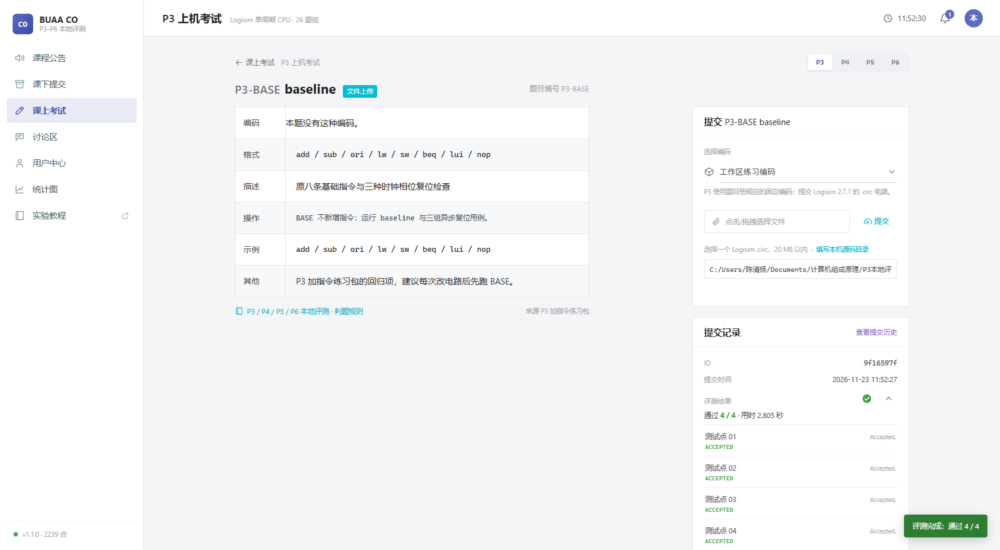
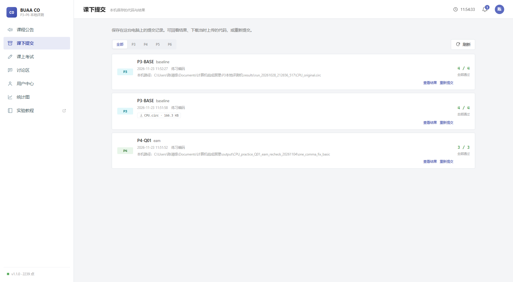
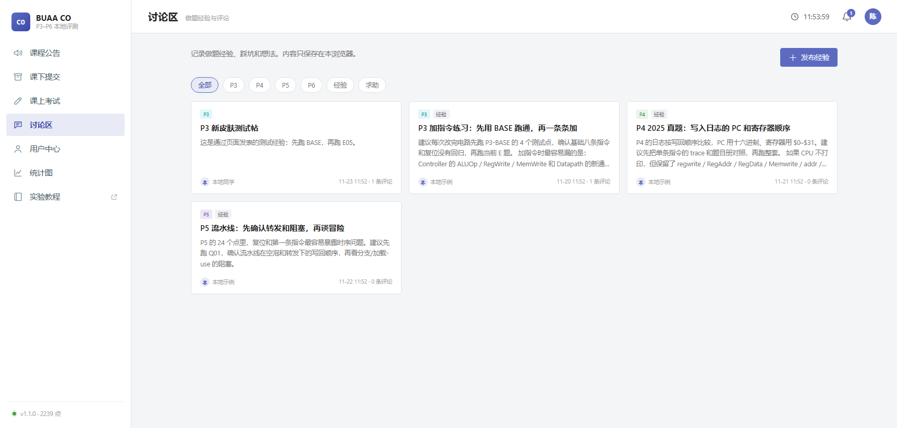
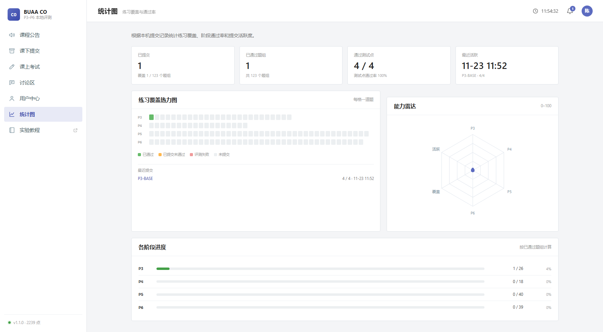
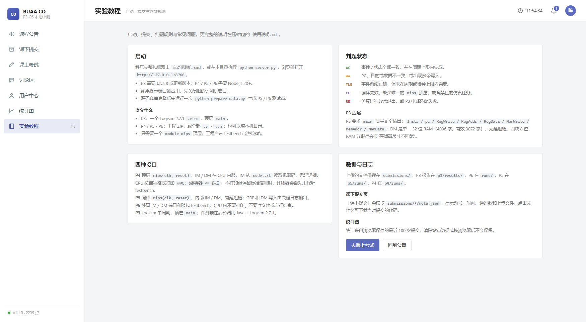
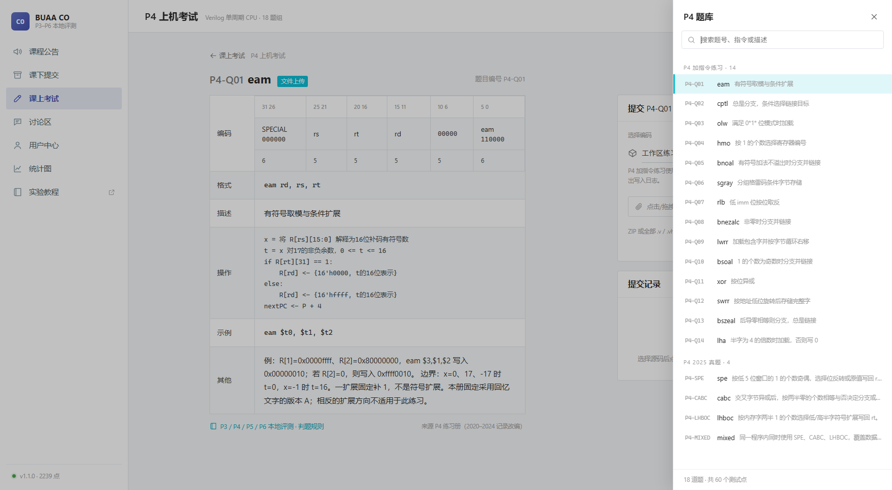

# BUAA-CO-P3-P6-Local-Judge

北航「计算机组成原理」P3—P6 的**本地网页评测器**，把 Logisim 单周期 CPU（P3）、Verilog 单周期 CPU（P4/P5）和流水线 CPU（P6）的题面、提交、逐点判题、提交记录和练习统计放在同一个本机页面里。

当前版本 **v1.1.1**：在 v1.0.0 的题面 / 提交双栏之上，增加了参考课程平台的左侧导航和七个功能页面。

- **126 个题组、2311 个测试点**：P3 26/283、P4 18/60、P5 40/960、P6 42/1008。
- 只监听 `127.0.0.1`，不联网；P3 用随包的 Java + Logisim，P4/P5/P6 用随包的 Icarus WebAssembly。
- 课程公告、课下提交、课上考试、讨论区、用户中心、统计图、实验教程。
- 进入 P3 / P4 / P5 / P6 后，题目抽屉只显示该阶段；四个阶段是四个独立页面。

## 页面预览

| 课程公告 | 课上考试 |
|---|---|
|  |  |

| 题目 / 提交 | 课下提交 |
|---|---|
|  |  |

| 讨论区 | 统计图 |
|---|---|
|  |  |

| 实验教程 | P4 阶段题库 |
|---|---|
|  |  |

## 功能

- **课程公告**：版本更新、使用说明、P3 适配提醒。
- **课下提交**：从 `submissions/*/meta.json` 读取本机提交，显示题号、时间、通过数，下载当时上传的代码，或重新提交。
- **课上考试**：P3 / P4 / P5 / P6 四张入口卡；进入后是题面 / 提交双栏，顶部阶段标签切换。
- **讨论区**：发布做题经验、标签筛选、详情、评论。
- **用户中心**：本地昵称、学号、邮箱、课程、头像颜色。
- **统计图**：练习覆盖热力图、能力雷达、各阶段进度、最近提交。
- **实验教程**：启动、提交、接口、判题状态与 P3 适配。
- 逐点 AC / WA / TLE / CE / RE；`?job=<id>` 可回看；服务重启后仍可从 meta 恢复。

## 支持阶段

| 阶段 | 内容 | 测试点 | 顶层接口 | 评测后端 |
|---|---|---|---|---|
| P3 | BASE + E01—E25 加指令练习 | 283 | Logisim `main`，8 个输出 | Java 8+ / Logisim 2.7.1 |
| P4 | 14 道加指令练习 + 2025 真题 | 60 | `mips(clk, reset)`，无延迟槽 | Icarus wasm（可 native） |
| P5 | 29 往年 + 10 模拟 + BLZTAL | 960 | `mips(clk, reset)`，有延迟槽 | Icarus wasm（可 native） |
| P6 | 24 往年 + 15 模拟 + Q25–Q27 | 1008 | 外置 IM/DM，随包 testbench | Icarus wasm（可 native） |

P3 评测器要求单一 32 位 RAM（4096 字，有效 3072 字）和课程 8 输出接口；四块 8 位 RAM 分银行的电路会报“存储器尺寸不匹配”。

## 快速开始

环境：**Python 3.9+**、**Node.js 20+**；P3 另需 **Java 8+**。Windows 10/11 已测试。

```powershell
git clone <this-repo> BUAA-CO-P3-P6-Local-Judge
cd BUAA-CO-P3-P6-Local-Judge

# P5 / P6 的派生测试点不在 Git 中，首次运行生成一次（约几十秒）
python prepare_data.py

# 启动本机评测网页
.\启动评测机.cmd
# 或者：python server.py
```

浏览器打开 <http://127.0.0.1:8766>。如果提示端口被占用，先关闭旧的评测机窗口。

> P3 / P4 的 283 + 60 个测试点随仓库提供；`prepare_data.py` 只生成 P5 / P6 的 960 + 1008 点（约 87 MB，已加入 `.gitignore`）。

## 部署到 Render

仓库里已经带 `Dockerfile` 和 `render.yaml`，可以直接用 Render 的 Blueprint 部署：

1. Render Dashboard → **New → Blueprint**，连接仓库 `BUAA-CO_P3-P6-local_judge`，分支 `main`；
2. Render 读取 `render.yaml`，创建 Standard（2 GB）新加坡服务、1 GB 持久磁盘；
3. 按提示设置 `ACCESS_CODE`（访问码，建议长随机串）；
4. Apply，等待 Docker 构建；构建时会运行 `prepare_data.py` 生成 P5 / P6 测试点；
5. 打开生成的 `https://buaa-co-p3-p6-judge.onrender.com`（名称重复时会带后缀），输入访问码。

说明：

- P3 的 Java 需要 2 GB 内存，Starter 512 MB 容易 OOM；`render.yaml` 默认 `plan: standard`。
- `ALLOW_SOURCE_PATH=0`，公网版只接受上传，不允许填写服务器本机路径。
- 磁盘只挂载 `/app/submissions`，提交记录和上传文件会保留；`runs/` 等运行日志在实例重启后失效。
- `ACCESS_CODE` 为空时站点对所有人开放；公开部署请务必设置。
- 这只是访问码，不是完整多用户认证；判题进程仍在服务容器内运行，不建议对完全陌生的人开放。
## 页面与路由

```text
#/announcements          课程公告
#/submissions            课下提交
#/exams                  课上考试
#/exam/P3                进入 P3 题目页（默认上次题目或 P3-BASE）
#/problem/P3-E05         直接打开某题
#/discussion             讨论区
#/profile                用户中心
#/stats                  统计图
#/tutorial               实验教程
?job=<id>                回看某次提交
```

- 从「课上考试」进入 P3 / P4 / P5 / P6 后，题目抽屉只渲染该阶段的题组；抽屉标题变为「P3 题库」等。
- 顶部阶段标签 `P3 P4 P5 P6` 始终可见；切换阶段会打开该阶段上次的题（或第一题）。
- 旧链接 `?problem=P3-E05` 仍兼容；新链接优先使用 hash 路由。

## 使用

1. 点「课上考试」，选 P3 / P4 / P5 / P6。
2. 确认编码模式：
   - P3 只提交一个 Logisim `.circ`；
   - P4 / P5 / P6 提交一个 ZIP，或当前工程的全部 `.v` / `.vh`，也可以填写本机源码目录。
3. 点「提交」，测试点实时刷新；点某一测试点展开周期、上限、首个差异或 P3 的失败信号。
4. 「课下提交」可回看结果、下载上传的代码、重新提交；「统计图」按最近 100 次提交计算。

### P3 提交

```text
java -Dfile.encoding=UTF-8 -Xmx768m -cp "p3/practice.jar;p3/lib/*" PracticeRunner
     --root p3 --cpu CPU.circ --exercise E05 --out p3/results/run_...
```

原 `.circ` 不会被修改；结果目录保留电路快照、带测试 ROM 的副本、`results.csv` 和失败定位文件。

### P4 / P5 / P6 提交

- 只需要一个 `module mips` 顶层；工程自带 testbench 会被忽略。
- P4 / P5 的 CPU 按课程格式打印 `@PC: $寄存器 <= 数据`；P4 如果不打印但保留 `regwrite / RegAddr / RegData / Memwrite / addr / WD / pc`，评测器会自动使用探针 testbench。
- P6 使用外置 IM/DM；CPU 内不要打印、不要读文件或自行结束。

## 课下提交的持久化

`server.py` 在创建任务时写 `submissions/<job_id>/meta.json`，完成后更新为 done / error，并保留精简的逐点状态：

```text
GET /api/submissions
GET /api/submissions/<job_id>/file/<name>
```

文件接口只接受 32 位十六进制任务号，拒绝 `..`、绝对路径和 `meta.json`；仅监听本机。上传的文件保存在 `submissions/<job_id>/`，可在「课下提交」直接下载。

## 前端数据

| 数据 | localStorage 键 |
|---|---|
| 提交历史（最近 100 次） | `p6web.history.v1` |
| 用户中心 | `p6web.profile.v1` |
| 讨论区帖子与评论 | `p6web.posts.v1` |

讨论区首次打开会写入三条示例帖（作者「本地示例」）；示例帖不可删除，用户帖可以删除。统计图按历史 + 题库实时计算。

## 目录

```text
index.html             七页 SPA 外壳与题目页
assets/                样式、路由、视图、判题交互
server.py              HTTP 服务、阶段路由、/api/submissions
prepare_data.py        生成 P5 / P6 测试点
p3/                    P3 题面、cases.tsv、tests/、practice.jar、lib/、src/
p4/                    P4 练习与 2025 真题、tests/、judge.py
p5/                    P5 题面、tests/（生成）、judge.py、make_cases.py
judge.py, cases.json   P6 题面与判题器
tests/                 P6 测试点（生成）
tools/, runtime/       wasm runner、Icarus WebAssembly
docs/images/           README 截图
使用说明.md             四阶段与网页导航、数据说明
网页改版说明.md          v1.1.1 多页面、路由、API、验证
```

P3 / P4 / P5 / P6 的题面、编码和测试点保持各自原包不变；网页只负责展示、提交和逐点结果。

## 已验证

| 项目 | 结果 |
|---|---|
| P3 BASE（单 RAM 基础 CPU，新页面提交） | 4 / 4 AC，2.8 s |
| P4-Q01 eam | 3 / 3 AC |
| P4-SPE / CABC / LHBOC / MIXED | 7/7、5/5、5/5、1/1，合计 18 / 18 AC |
| P5-Q01 cco | 24 / 24 AC |
| P6-Q11 shl（原平台编码） | 24 / 24 AC |
| 题库接口 | 126 题，分组 26 / 14+4 / 29+10+1 / 24+15+3 |
| 页面 | 1750×963、1024×800、390×844 无横向溢出 |
| 课下提交 | 3 条记录、P3 上传文件可下载；服务重启后 meta 仍可读 |
| 讨论区 / 用户中心 / 统计图 | 发帖、评论、标签筛选、删除、头像同步、热力图与雷达正常 |

测试结果只代表本包的练习标准，**不代表官方隐藏测试**。

## 已知限制

- **P3 电路适配**：只支持课程顶层接口和单一 32 位 RAM；四块 8 位 RAM 分银行的设计需要额外适配。P3 的 `.circ` 不会被修改，失败时查看 `p3/results/` 下的 `failure.txt`。
- **P3 编码**：E01—E25 是按 2020—2024 记录补齐的练习，编码和边界是练习规定，不是官方原题编码。
- **P4 2025**：网页比较写入日志；`p4/exam2025/grade.py` 还可额外核对最终 GRF / DM / PC。
- **P5 / P6**：`prepare_data.py` 生成的测试点约 87 MB，不提交到 Git；克隆后必须先运行一次。
- **平台**：P3 的 Java classpath 使用 Windows 分号；Linux/macOS 未测试，P4/P5/P6 的 wasm 路径理论可移植。
- **本地数据**：讨论区、用户中心、提交历史只在浏览器 localStorage；清除站点数据或换浏览器不会保留。

## 第三方与许可

本仓库的**前端、服务端、judge 包装和文档**采用 MIT（见 `LICENSE`）。仓库同时包含：

- Icarus Verilog WebAssembly 运行库（GPL-2.0）；
- Logisim 2.7.1、MARS 4.5、P3 `practice.jar` / `p3judge.jar`；
- 北航计组课程题面、往年题记录和测试数据。

这些组件的版权归各自作者所有，**不适用 MIT**；再分发时请遵守 `p3/licenses/` 与 `runtime/README.md` 中的许可。课程题面和测试数据仅用于个人练习，不代表官方发布。详见 `NOTICE.md`。

## 致谢

- P5 / P6 题面与测试思路来自 [cqy20070511/BUAA_CO_P5-P6_practice](https://github.com/cqy20070511/BUAA_CO_P5-P6_practice)；
- P3 / P4 题目与练习包来自本地整理的历史资料与公开博客，来源见各阶段文档；
- Icarus Verilog、Logisim、MARS 的作者与维护者；
- 界面布局参考课程平台截图，仅用于本地练习页的样式还原。
